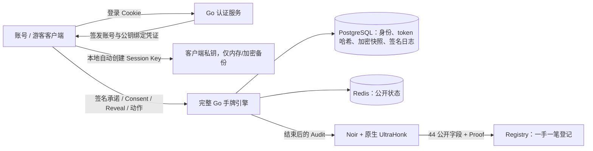

# 架构：账号/游客与客户端密钥

玩家不连接钱包。登录身份 identityId 在数据库中稳定，游客升级账号保留 identityId；链上 playerId 是本次客户端公钥承诺，换密钥会换 playerId。证书和签名把二者绑定；账号名称真实性依赖认证服务，已入桌公钥的动作真实性依赖客户端私钥。

Argon2id 密码哈希、随机 HttpOnly Cookie、数据库 token 哈希、同源 JSON 写入检查和有限登录尝试用于基本账号认证。生产需要 HTTPS、Secure Cookie、可信代理下的用户限流、审计/监控、账号恢复和独立安全审查。

Go 引擎继续处理完整下注、短加注/累计重开、All-in、未跟注返还、边池、7 张牌比较、平局和余筹。原子状态转移先在副本执行。固定九座支持 2–9 人，单手协议不含自动续桌和资金账本。

Postgres 为权威源。动作验签后在同一事务更新版本、AES-GCM 快照及追加收据；提交后才返回 ACK。撤销与接受通过会话行锁串行，相同动作重试返回原 ACK。快照密钥来自持久化服务器密钥，handId 是 GCM 关联数据；丢失密钥将无法恢复。生产需独立 KMS/轮换设计。

Redis 不保存种子/完整牌序/Hole，不承担真实性。公开 API 只展示公共状态；私有读取须有效 Session 签名，按 accountId 只返回自己的底牌。服务重启恢复数据库日志；客户端刷新必须恢复原签名密钥才能继续原手牌。重新登录可为该账号历史读取签发新会话，不能冒充旧公钥行动。

完整电路入口 `apps/prover/hand/src/main.nr` 组合 crypto/engine/shuffle/betting/showdown/hand，静态最多 64 动作，未使用槽强制为零。新认证关系真实约束，不以服务端布尔值替代验签。SHA 填充/打包有约束，压缩与 ECDSA 用 Noir 标准黑盒；Keccak 使用固定官方库。

运营端独立生成 UltraHonk ZK Proof，不将高内存 prover 作为无限制 HTTP 接口。ACIR/VK/生成 Verifier 记录指纹，部署和证明前核对。Registry 的 authIssuer 不可变，公开字段由自身 chainId/地址和参数构造，Hash 拆为无损 128-bit limbs；没有取模摘要别名。

正常结算只有一笔 verifyHand，部署和显式会话撤销不算每手交易；当前链下撤销不产生交易，也不能由链上推断其历史。没有真实代币转账。生成合约保留正常 EIP-170 大小限制。

v3 使用新 API/哈希域/表/VK，旧数据未删除。历史 v2 文档和基准保留在 history，当前验收以本轮文档和实际报告为准。Amoy 尚未部署，不宣称生产可用。
