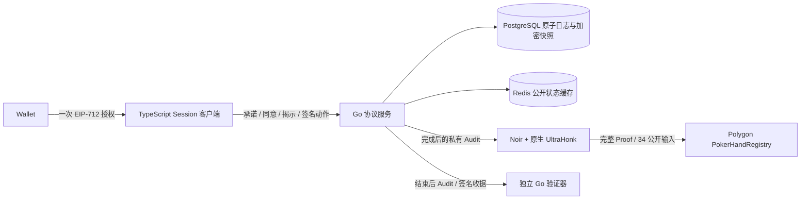

# 架构与实现边界

这些连线均有本地运行实现。完整证明通过独立 CLI 进程生成；HTTP 服务不将不可信请求直接转为高内存证明任务。Amoy/主网尚未实际部署，详见验收记录。

## 游戏执行

Go 单手引擎为 `Preflop → Flop → Turn → River → Complete`，只剩一个未 Fold 玩家则直接结算。外部不能指定赢家、边池或最终筹码。`Hand.Apply` 在副本执行，通过规则及守恒检查后提交。完整 52 张牌经验证后，按 Button 左侧起轮发两轮，每条公共街先 Burn。

完整加注增量与各玩家上次面对的下注额分别保存，处理短 All-in 与累计重开。没有可响应对手时禁止空边池下注。每街返还未跟注投入，所有余下玩家 All-in 则自动 Runout。边池按投入档位产生，Fold 者贡献但不能赢；七张牌枚举 21 个五张子集，每池独立平分并顺时针分配余筹。

v2 每手签署 1–64 的动作上限，达到上限仍未完成或超过截止时间则中止；不伪造 Fold、不用截断记录出具正常完成证明。Noir 静态支持 64 个动作，未使用 witness 槽强制为零。该资源界限并不代表德州扑克合法手牌永远只有 64 个动作。

## 持久化与恢复

PostgreSQL 是权威状态源。会话唯一键绑定钱包、域和 nonce；授权/撤销持久化。修改手牌时持有会话共享锁与手牌行锁，校验版本后在同一事务中追加收据、更新 AES-GCM 加密快照。ACK 只在提交后返回。同一已接受动作重发返回原收据；相同序号的不同 payload 拒绝。

Redis 仅缓存不含 Hole、种子和完整牌序的公开状态，不决定验签或筹码真实性。快照包含回放必要的签名与随机性，使用持久化服务器密钥派生的 AES-256-GCM 密钥加密，handId 为关联数据，每次随机 nonce；服务器密钥丢失不能恢复，泄露则数据库保密性和服务器收据身份同时失守。生产环境需独立 KMS 与密钥轮换设计。

恢复请求由 Session Key 签署，包含 handId、上下文和短时间戳。客户端带最后收到的收据索引和哈希，服务核对整个收据链、快照头及光标，再返回尾部事件、公开状态和该钱包自己的底牌。已授权的新 Session 可恢复同一钱包在相同域/桌下的历史读取权限；当前手牌的动作始终需要原 roster Session。WebSocket 是可丢失传输；数据库记录才代表接受。

签名收据 payload 使用原始 JSON 字节的 Base64 表示，避免 PostgreSQL jsonb 重排空白/字段后改变摘要。数据库内存储的游戏私密数据加密；服务器进程按需求仍知道完整牌序。

## 完整证明

完整二进制关系在 `apps/prover/hand`，使用 `circuits/crypto`、`engine`、`shuffle`、`betting`、`showdown`、`hand`。其中 `circuits/hand` 是结算库，不是缺失的完整入口。约束包括：

1. 公开网络/Registry/HandID/玩家/初末筹码/截止时间；私有规则、桌 ID、授权、随机性和动作。
2. 钱包 EIP-712 授权签名与 Session 公钥身份；各玩家共同同意冻结 Manifest 的签名。
3. 所有种子承诺、按座位混合、52 张牌的 SHA256 优先级排序与牌序承诺。仅证明排列合法远远不够。
4. 逐动作签名、序号/前状态链、公共牌面与筹码摘要、玩家种子遮蔽的底牌承诺、完整状态转移。
5. 发牌、Burn、短加注重开、未跟注返还、7 张牌比较、边池分配和最终筹码。

SHA256 的填充和字节打包使用约束代码，压缩函数使用标准黑盒；没有用空函数或未约束 witness 替代关系。Keccak 使用 vendored 官方库，ECDSA 使用 Noir secp256k1 黑盒。使用固定版 Barretenberg 原生 CLI 的 UltraHonk、Keccak oracle，默认 ZK 开启，不传 `--disable_zk`。

`prepare-hand` 记录 ACIR、VK 与生成 Solidity 的 SHA256 指纹，复制公开 Verifier 到 contracts。证明和部署前核对指纹，防止电路与 Verifier 错配。临时 witness/audit 含敏感信息，忽略于 Git，应限制 prover 工作目录权限并在生产中单独处理。

## 链上结果

Registry 构造 34 个公开字段直接交给真实 Verifier。256 位 handId 和协议承诺拆为两个无损 128 位值；没有对摘要取模。chainId 和 Registry 地址由当前链和合约自身构造，防止跨域重放。记录身份、初始/最终筹码、协议承诺、截止时间、索引 Digest，发出 `HandVerified`。

正常完成只调用一次 `verifyHand`；部署不算手牌交易。截止后不能登记，重复 HandID 拒绝。链上不跟踪钱包授权撤销历史，也不证明消息真实发布时间；截止时间由共同签名绑定，并由链上时间执行。Registry 不验证跨手筹码连续性，不是资金账本，没有代币转账或异常争议合约。

当前为单手服务与会话客户端，不包括多手自动移位、重新买入、比赛升盲或房间运营系统。主网工具要求同一 VK 的 Amoy 成功记录与显式开关；该门禁不能替代安全审计。
